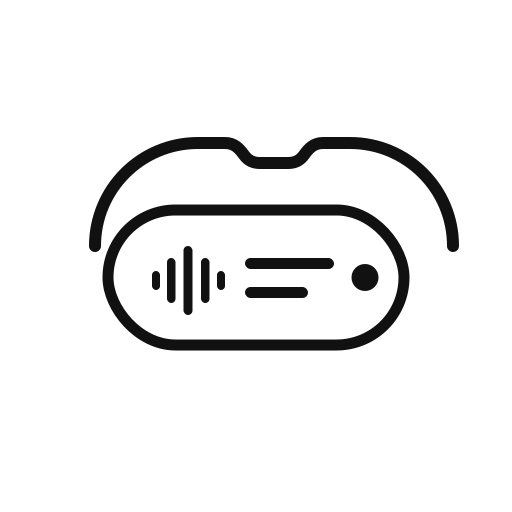

<p align="center">
  <picture>
    <source media="(prefers-color-scheme: dark)" srcset="assets/logo/website/overlid-white-512.png">
    <source media="(prefers-color-scheme: light)" srcset="assets/logo/website/overlid-black-512.png">
    
  </picture>
</p>

<p align="center"><strong>Overlid: a dynamic island for Windows with AI coding status and a notch teleprompter.</strong></p>

---

Overlid sits at the top of your screen (centre, or flush in a corner), stays out of the way, and opens on hover.

- **Collapsed pill**: the time, always centred, plus whatever's active to its right: now playing (click to play/pause), your focus timer, AI usage and a quick action button.
- **Media**: what's playing in Spotify, a browser or any app that uses Windows media controls. Album art, play/pause, skip, seek, and an accent colour taken from the cover.
- **System**: CPU, memory, battery, uptime and free disk. Caps Lock and Num Lock blink inside the pill; charger and low battery pop out briefly. Hides itself during full-screen video, games and presentations.
- **Focus**: a Pomodoro timer that keeps running when you close the panel. Click the time to change it; quick 5 · 15 · 25 · 50 presets.
- **AI tools**: usage rings for the tools you connect (Claude Code, Codex, GitHub Copilot), plus live Claude Code session status. When a session needs you, a ringing bell stays in the pill until you deal with it.
- **Teleprompter**: your script scrolls out of the notch, right under your webcam. Smooth scrolling with a reading line, timing by speed, lines per minute or "finish in N minutes", voice mode that only moves while you talk, resizable area, import from .txt, .md, .docx or .pdf, and an optional ambient glow. Hidden from screen share and recordings while you present.

<!-- Add GIFs here: docs/media/island.gif, docs/media/prompter.gif, docs/media/codenotch.gif -->

## Install

Download the latest `Overlid_x.y.z_x64-setup.exe` from [Releases](https://github.com/Vigesh-VS/overlid/releases) and run it. It installs for your user only, no admin needed. Launching Overlid opens its home window; the island keeps running in the tray after you close it. Right-click the tray icon for Settings, Game mode, Pause island, Start with Windows and Quit.

Requires Windows 10 version 2004 or later (for screen-capture protection) and the WebView2 runtime, which Windows 11 already has.

### Check your download

Every release has a `SHA256SUMS.txt` next to the installer. In PowerShell, in the folder you downloaded to:

```powershell
(Get-FileHash .\Overlid_x.y.z_x64-setup.exe -Algorithm SHA256).Hash.ToLower()
```

The result must match the line for that file in `SHA256SUMS.txt`. If it doesn't, delete the file and download it again from the Releases page only.

**SmartScreen:** the installer isn't code-signed yet, so Windows may show "Windows protected your PC". Check the checksum first, then choose **More info › Run anyway**. Only do this for files from this repository's Releases page.

## Using it

| Do this | To |
|---|---|
| Hover the notch | Open it. It closes after the close delay (0.4 s by default). |
| Click a tab | Switch between Home, Media, Code, Prompter, Focus and Stats. |
| Click the album art in the pill | Play / pause. |
| Click the album art in the Media panel | Switch players when more than one is playing. |
| Click the bell | Open the Claude Code session that needs you. |
| Hover a peek | Open the panel it's about. |
| ⚙ in the open island | Open Settings. |

### Teleprompter shortcuts

All of these can be changed in Settings › Teleprompter. Only the first is active when you're not presenting.

| Shortcut | Action |
|---|---|
| `Ctrl+Alt+P` | Start or stop the prompter |
| `Ctrl+Alt+Space` | Play / pause |
| `Ctrl+Alt+↑` / `↓` | Faster / slower |
| `Ctrl+Alt+=` / `-` | Bigger / smaller text |
| `Ctrl+Alt+←` / `→` | Previous / next section |
| `Esc` | Stop (when the island has focus) |

Lines that start with `## ` are sections you can jump to. Hover the prompter to pause it; drag its left, right and bottom edges to resize it. In voice mode, use Settings › Teleprompter › Calibrate once so the threshold sits just above your room noise.

### Connecting AI tools

Open Settings › AI tools and click **Connect** next to a tool. Overlid looks for the sign-in that tool's own CLI already saved on your PC and asks before using it. If there isn't one, it tells you the command to sign in:

| Tool | Sign in with |
|---|---|
| Claude Code | `claude`, then `/login` |
| Codex | `codex login` (ChatGPT sign-in) |
| GitHub Copilot | `gh auth login` |

The first connected tool is the primary one, shown in the pill. These usage endpoints are unofficial, so numbers are marked *derived*, and Overlid shows stale or needs-sign-in states rather than guessing.

**Live Claude Code sessions** are separate: click **Connect live sessions**. Overlid then:

1. backs up `~/.claude/settings.json` to `settings.json.overlid-backup-<timestamp>`,
2. adds one `"type": "http"` hook per event, pointing at `http://127.0.0.1:47823/hook` and carrying a random per-install `X-Overlid-Token` header,
3. leaves your own hooks and every other setting untouched.

**Disconnect** removes only Overlid's entries, and so does uninstalling Overlid. When Overlid isn't running, the hooks fail quietly and Claude Code carries on as normal. Overlid only ever edits `%USERPROFILE%\.claude\settings.json` (a `CLAUDE_CONFIG_DIR` override isn't used for hooks), and won't edit it through a symlink or junction.

## Privacy

- No telemetry, no accounts.
- Usage is only fetched for tools you connect. Their saved sign-ins are only read, never written, refreshed or logged, and each is sent only to that tool's own usage endpoint (Anthropic, ChatGPT or GitHub).
- The hook receiver listens on `127.0.0.1` only and rejects anything without its per-install token, anything from a browser (an `Origin` header or a foreign `Host`), and oversized or malformed events. It keeps only the event, session id, folder and a short message; tool inputs, prompts and transcripts are never read.
- Network requests go only to the three usage endpoints, over HTTPS, with no redirects.
- Logs stay on your PC (up to 4 × 1 MB) and mask anything that looks like a token.
- Settings › About lists everything stored locally and has **Clear all Overlid data**.
- Voice mode measures microphone loudness in memory. Audio is never recorded, stored or sent.
- The ambient background's "live screen colour" averages a tiny 16×9 copy of the screen once a second, only while presenting, in memory only.
- Caps Lock and Num Lock are read with `GetKeyState`. There is no keyboard hook.

Found a security problem? See [SECURITY.md](SECURITY.md).

## Build from source

Prerequisites:

- [Rust](https://rustup.rs) stable with the MSVC toolchain
- Visual Studio Build Tools with **Desktop development with C++**
- Node.js 20 or later

```powershell
git clone https://github.com/Vigesh-VS/overlid.git
cd overlid
npm install
npm run tauri dev      # run with hot reload
npm run tauri build    # installer in src-tauri/target/release/bundle/nsis/
```

Checks before sending a PR:

```powershell
cargo clippy --manifest-path src-tauri/Cargo.toml --all-targets
cargo test --manifest-path src-tauri/Cargo.toml
npm run build
```

`cargo run --manifest-path src-tauri/Cargo.toml --example mic_probe` prints your default microphone's format and 3 s of levels, which helps when debugging voice mode.

## How it's built

Tauri 2 (Rust) with a React 18 + TypeScript front end, Framer Motion for the island animations and Zustand for state.

Rust owns everything that touches Windows (SMTC media sessions, power status, lock keys, full-screen and foreground detection, the hook server, the microphone, screen colour sampling) and the state that must outlive the UI, like the Pomodoro timer. It emits typed events, and the front end renders them and sends commands back. Every event and command is typed in [`src/lib/ipc.ts`](src/lib/ipc.ts).

The island is a single transparent window that never resizes while you use it. The notch animates inside it, and a hit-rect loop in Rust turns click-through off only while the cursor is over the notch, so clicks pass straight through to apps everywhere else. All design tokens, including the global `--ui-scale`, live in [`src/styles/tokens.css`](src/styles/tokens.css).

Adding another AI provider means implementing the `UsageProvider` trait in [`src-tauri/src/codenotch/mod.rs`](src-tauri/src/codenotch/mod.rs) and registering it in `providers()`.

## Inspired by

Overlid takes ideas, not code, from these MIT-licensed projects. Thank you to their authors.

- dynamic-island-for-windows by rajsriv, and Nusa
- CodeNotch by vinzdg, and codenotch-windows by MakFly
- TopCue, NotchPrompter and Moody

See [THIRD_PARTY_NOTICES.md](THIRD_PARTY_NOTICES.md).

## License

Code: [MIT](LICENSE) © 2026 Vigesh.

The Overlid name and logo are © 2026 Vigesh and **not** covered by the MIT licence; forks need their own branding. See [assets/logo/LICENSE-NOTE.md](assets/logo/LICENSE-NOTE.md).
