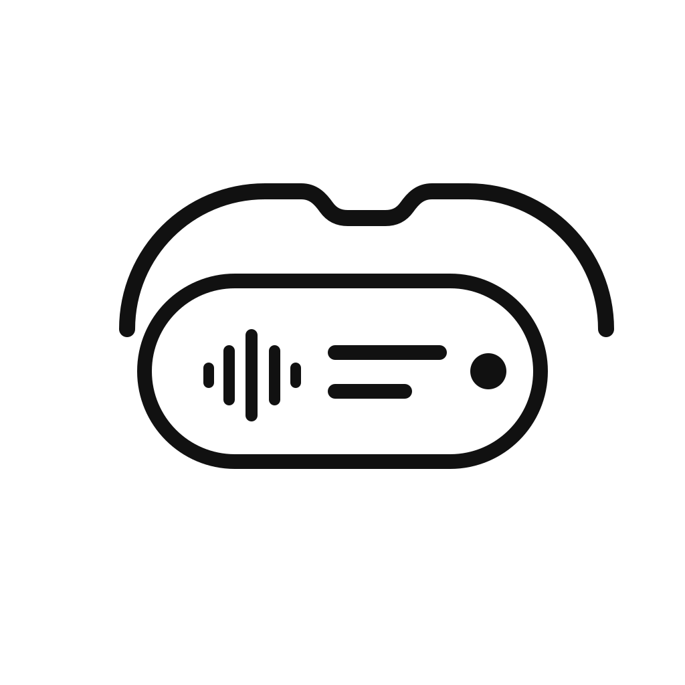
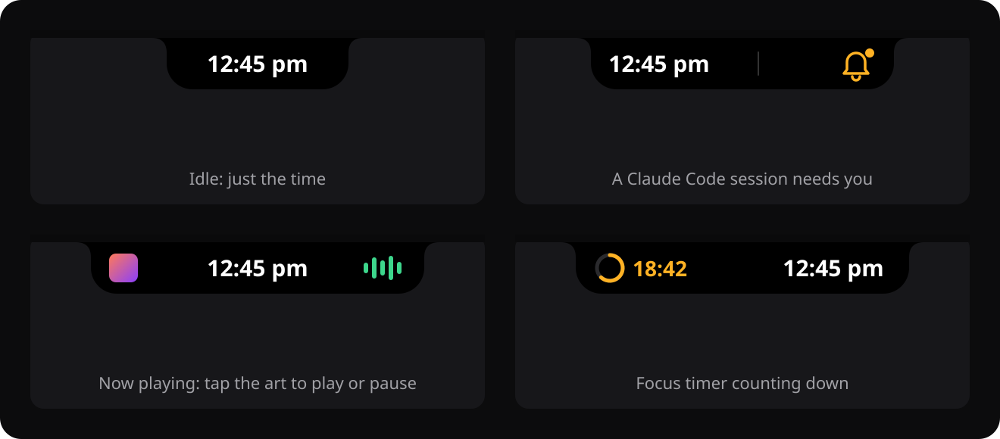
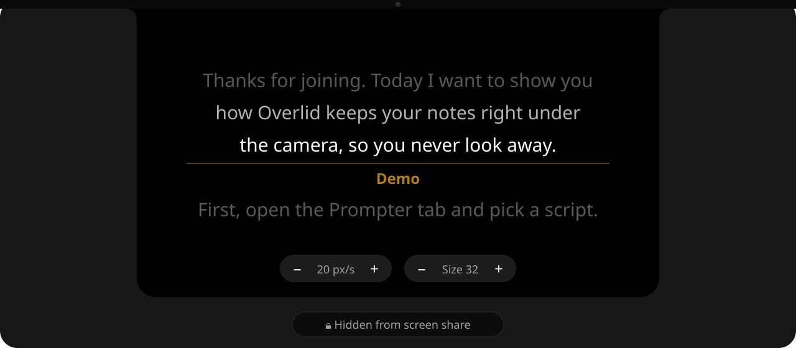

<p align="center">
  <picture>
    <source media="(prefers-color-scheme: dark)" srcset="assets/logo/source/overlid-white.svg">
    <source media="(prefers-color-scheme: light)" srcset="assets/logo/source/overlid-black.svg">
    
  </picture>
</p>

<h1 align="center">Overlid</h1>

<p align="center"><strong>A dynamic island for Windows with AI coding status and a notch teleprompter.</strong></p>

<p align="center">
  <a href="https://github.com/Vigesh-VS/OverLid/releases/latest"></a>
  <a href="https://github.com/Vigesh-VS/OverLid/releases"></a>
  <a href="LICENSE"></a>
  
  <a href="https://tauri.app"></a>
  <a href="https://github.com/Vigesh-VS/OverLid/actions/workflows/ci.yml"></a>
</p>

<!-- Hero GIF: replace the illustration below once docs/images/hero.gif exists.
<p align="center"></p>
-->
<p align="center"></p>

Overlid puts a small black notch at the top of your screen. It shows the time, and what matters right now: the song that's playing, your focus timer, or a Claude Code session that needs you. Hover it to open, move away and it's gone. When you present, it turns into a teleprompter right under your webcam, hidden from screen share.

**[Download for Windows](https://github.com/Vigesh-VS/OverLid/releases/latest)** · [Quick start](#quick-start) · [Privacy & security](#privacy--security) · [Build from source](#build-from-source)

## Features

| | |
|---|---|
| 🏝️ **Island** | A pill that blends with your bezel and opens on hover. Alerts split it like a Dynamic Island: the time slides left, the alert pops in on the right. Centre or corner placement, size and scale settings, and it hides during full-screen games and presentations. |
| 🎵 **Media** | Now playing from Spotify, browsers or any app with Windows media controls. Album art, play/pause, skip, seek, and an accent colour from the cover. |
| 🤖 **CodeNotch** | Usage rings for **Claude Code**, **Codex** and **GitHub Copilot**, using each CLI's existing sign-in. Live Claude Code sessions show busy, done and **"needs you"**, with a bell that stays in the pill until you look. |
| 📜 **Teleprompter** | Your script scrolls out of the notch, under the camera. **Voice mode** scrolls only while you talk. **Hidden from screen share.** Import .txt, .md, .docx and .pdf. Resize from any edge, jump between sections, and use global shortcuts. |
| ⏱️ **Focus timer** | A Pomodoro timer that keeps running when the panel closes, with a ring in the pill, presets and today's total. |
| ⚡ **Quick action** | One button in the pill: launch an app, open a site or folder, start the timer or the prompter, or play/pause. |
| 🎨 **Customisation** | Position, width, height, scale, close delay, which indicators show, per-type peeks, prompter fonts and colours, and an optional ambient glow. |

<p align="center"></p>

<!-- Feature screenshots: uncomment each line once the file exists in docs/images/.
<p align="center"></p>
<p align="center"></p>
<p align="center"></p>
<p align="center"></p>
<p align="center"></p>
-->

## Download & install

1. Download `Overlid_x.y.z_x64-setup.exe` and `SHA256SUMS.txt` from the **[latest release](https://github.com/Vigesh-VS/OverLid/releases/latest)**.
2. Check the download (optional but recommended). In PowerShell, in your Downloads folder:

   ```powershell
   (Get-FileHash .\Overlid_0.2.0_x64-setup.exe -Algorithm SHA256).Hash.ToLower()
   ```

   The result must match the line for that file in `SHA256SUMS.txt`. If it doesn't, delete the file and download it again from the Releases page.
3. Run the installer. It installs for your user only; no admin rights are needed.

> **"Windows protected your PC"?** The installer isn't code-signed yet, so SmartScreen may warn you. After checking the checksum, click **More info → Run anyway**. Only do this for files from this repository's Releases page.

Requires Windows 10 version 2004 or later, or Windows 11, with the WebView2 runtime (built into Windows 11).

## Quick start

**First launch.** Overlid opens a welcome screen and puts an icon in the tray. The notch sits at the top of your main screen: hover it to open, and use the ⚙ inside, or right-click the tray icon, for Settings.

**Connect Claude Code.**

1. Settings › **AI tools** › **Connect** next to Claude Code shows your usage. It reads the sign-in Claude Code already saved; if there isn't one, run `claude` and `/login` first. Codex (`codex login`) and Copilot (`gh auth login`) work the same way.
2. **Connect live sessions** adds Overlid's hooks to `~/.claude/settings.json`, after making a backup. From then on the pill shows when a session is busy, done or needs you. **Disconnect**, or uninstalling Overlid, removes only Overlid's entries.

**Start the teleprompter.** Open the notch › **Prompter** tab, pick a script (or drop in a .txt, .md, .docx or .pdf) and press **Start**. After a 3-2-1 countdown it scrolls. Hover to pause, drag the edges to resize, and turn on voice mode in Settings › Teleprompter. Lines starting with `## ` are sections you can jump to.

### Keyboard shortcuts

You can change these in Settings › Teleprompter. Only the first works when you're not presenting.

| Shortcut | Action |
|---|---|
| `Ctrl+Alt+P` | Start or stop the prompter |
| `Ctrl+Alt+Space` | Play / pause |
| `Ctrl+Alt+↑` / `↓` | Faster / slower |
| `Ctrl+Alt+=` / `-` | Bigger / smaller text |
| `Ctrl+Alt+←` / `→` | Previous / next section |
| `Esc` | Stop (when the island has focus) |

## Privacy & security

- **Local only.** No accounts, no telemetry, no analytics.
- **Your tokens stay put.** Overlid only *reads* the sign-ins your AI tools already saved. It never writes, refreshes, logs or shows them, and each one goes only to its own tool's usage endpoint over HTTPS.
- **A locked-down hook receiver.** It listens on `127.0.0.1` only, needs a per-install token, and refuses browsers and malformed events. It never reads your prompts or tool data.
- **Nothing recorded.** Voice mode measures loudness in memory, and the ambient glow keeps only an average colour. There's no keyboard hook.
- **You're in control.** Settings › About lists everything stored on your PC and has **Clear all Overlid data**.

Details in [SECURITY.md](SECURITY.md). To report a vulnerability, use GitHub's private **Report a vulnerability** on the Security tab.

## Build from source

Prerequisites:

- Windows 10/11
- [Rust](https://rustup.rs) stable (MSVC toolchain)
- Visual Studio Build Tools with **Desktop development with C++**
- Node.js 20+

```powershell
git clone https://github.com/Vigesh-VS/OverLid.git
cd OverLid
npm install
npm run tauri dev      # run with hot reload
npm run tauri build    # installer in src-tauri/target/release/bundle/nsis/
```

Checks (CI runs these too):

```powershell
cargo clippy --manifest-path src-tauri/Cargo.toml --all-targets -- -D warnings
cargo test --manifest-path src-tauri/Cargo.toml
npm test
npm run build
```

New to the code? Start with [docs/ARCHITECTURE.md](docs/ARCHITECTURE.md).

## Roadmap

- Code-signed installer (no SmartScreen warning) and in-app updates
- Bring the terminal or VS Code window for a Claude Code session to the front
- Multi-monitor placement
- More usage providers
- A floating teleprompter window

Ideas welcome in [Discussions](https://github.com/Vigesh-VS/OverLid/discussions).

## Contributing

Bug reports, ideas and pull requests are welcome. Please read [CONTRIBUTING.md](CONTRIBUTING.md) first. Changes are listed in [CHANGELOG.md](CHANGELOG.md).

## Inspired by

Overlid takes ideas, not code, from these MIT-licensed projects. Thank you to their authors.

- dynamic-island-for-windows by rajsriv, and Nusa
- CodeNotch by vinzdg, and codenotch-windows by MakFly
- TopCue, NotchPrompter and Moody

See [THIRD_PARTY_NOTICES.md](THIRD_PARTY_NOTICES.md).

## Licence

The code is [MIT](LICENSE) © 2026 Vigesh.

The Overlid name and logo are © 2026 Vigesh and **not** covered by the MIT licence; forks need their own branding. See [assets/logo/LICENSE-NOTE.md](assets/logo/LICENSE-NOTE.md).
